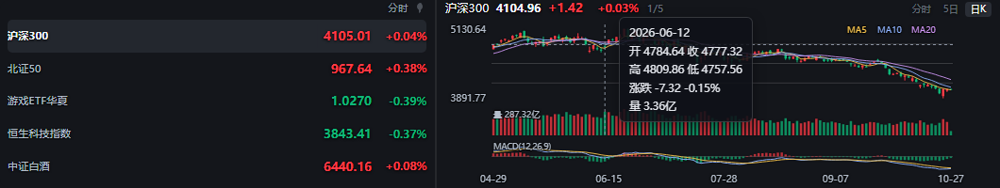

# Mini Ticker · 桌面盯盘浮窗

背景全透明的桌面行情浮窗。没有边框、没有面板、没有按钮堆叠，只有红绿折线和几个数字，贴在桌面任意角落，不挡视线。

**[⬇ 下载最新版](https://github.com/qqten/mini-ticker/releases/latest)** —— 一个安装包，装完就能自动更新，不用再手动下新版。


## 特性

- **真透明**：无边框浮窗，背景完全透过去，叠在浏览器、编辑器、壁纸上都行
- **自动配色**：实时采样窗口背后的画面，背景亮就自动转暗色字，背景暗就自动转亮色字，不用手动切
- **多市场**：A 股、港股、美股、指数、ETF、场外基金混着盯
- **场外基金也有分时线**：基金没有分钟行情，就每轮抓一次盘中估值自己攒成曲线，跟股票一样一条线看下来
- **四种周期**：分时 / 日线 / 月线 / 年线，`Ctrl+1~4` 秒切，右上角常驻当前周期标识
- **聚焦图表**：`Ctrl+Alt+F` 把浮窗向右加宽，左边照旧是列表、右边长出一块图表区（分时 / 5日 / 日K，K 线 + 均线 + 成交量 + MACD + 十字光标读数）
- **可伸缩**：鼠标移到浮窗任意一边拖动改宽/改高，松手记住；窄到 220px 也还能用，会自己收字号、把折线压成迷你条
- **按名字搜**：中文名、拼音首字母、代码都能搜，不用背代码
- **尾盘提醒**：到点弹通知 + 任务栏闪烁
- **收盘自动退出 / 自动启动**：收盘定时退出；自动启动走 Windows 计划任务，工作日定点拉起，节假日会跳过
- **自动更新**：安装版启动后静默检查，后台下好，等你正常退出时装上，不打断盯盘
- **单实例**：重复启动只会激活已有窗口


## 快速开始

### 下载哪个

只有一个包，直接下就行：

| 包 | 说明 |
| --- | --- |
| `MiniTicker-Setup-x.y.z.exe` | 装到用户目录（不需要管理员权限），带开始菜单快捷方式和自动更新 |

在 [Releases](https://github.com/qqten/mini-ticker/releases/latest) 里。配置和日志写在 `%APPDATA%\mini-ticker\`，装新版会沿用，卸载就是删掉程序目录和这个目录。

> 早先发过便携版（`MiniTicker-x.y.z-portable.exe`），但便携版每次自解压到临时目录，没有固定安装目录，**没法自动更新**，还得手动下新版覆盖，所以从 v1.0.5 起不再提供。

> 没有代码签名，Windows 首次运行会提示「未知发布者」，点「更多信息 → 仍要运行」。

### 自动更新

安装版启动 25 秒后自己查一次新版，发现就静默下载（不弹窗、不抢带宽）。**下完会弹一个「是否现在重启更新」的对话框**：点「立即重启」自己静默装好再把浮窗拉起来，大约 2 秒；点「稍后」就等你下次退出时自动装，下次打开就是新版 —— 不用自己去关窗口再点图标。

想手动控制就走**设置 → 关于**：

- 看当前版本和更新状态（未检查 / 正在检查 / 已是最新 / 下载中 xx% / 已下载）
- 点「检查更新」立刻查一次；如果已经下好了，会直接问你要不要现在换上
- 下好之后按钮变成「重启更新」，点了立刻重启装上
- 检查失败会显示原因，可以重试

连不上 GitHub（国内常见）就一直停在「检查失败」，这时去 Releases 手动下新版覆盖安装即可，`%APPDATA%` 里的自选和设置不会丢。

### 从源码跑

需要 Node.js 18 及以上。

```bash
git clone https://github.com/qqten/mini-ticker.git
cd mini-ticker
npm install
npm start
```

Windows 用户装好依赖后，直接双击 `start.cmd` 也行。

### 自己打包

```bash
npm install
npm run dist       # 出安装包：dist/MiniTicker-Setup-x.y.z.exe（+ latest.yml / blockmap，自动更新要用）
npm run pack:dir   # 只出 dist/win-unpacked 目录，调试打包问题用
```

打包用 electron-builder，只打 NSIS 安装包（便携版从 v1.0.5 起已去掉）：`electronDist` 指向本地已装好的 Electron，省去重复下载；图标是 `build/icon.ico`。国内网络下载 NSIS 资源慢的话，加镜像：

```bash
ELECTRON_BUILDER_BINARIES_MIRROR=https://npmmirror.com/mirrors/electron-builder-binaries/ npm run dist
```

> 目前主要在 Windows 上验证。macOS / Linux 可以用 `npm start` 跑起来，但自动更新、自动启动（Windows 计划任务）那套不适用。

## 用法

| 操作 | 效果 |
| --- | --- |
| 左键拖动 | 移动浮窗 |
| 左键单击 | 展开 / 收起聚焦图表 |
| 拖任意一边 | 改宽 / 改高（拖回内容高度会自动恢复自适应） |
| 鼠标滚轮 | 自选多到装不下时，列表上下滚动 |
| 右键 | 菜单：设置 / 检查更新 / 退出 |
| `Ctrl+1` ~ `Ctrl+4` | 切分时 / 日线 / 月线 / 年线 |
| `Ctrl+R` | 立即刷新 |
| `Ctrl+Alt+F` | 展开 / 收起聚焦图表（全局快捷键，浮窗没焦点时也能按） |

快捷键都能在**设置 → 快捷键**里改。

第一次使用建议右键 → 设置，把标的换成自己关心的。

涨跌幅跟着周期走：分时显示的是「今天涨跌」（相对昨收），切到日/月/年线后显示的是**这条折线覆盖区间的涨跌**（首点到末点），和曲线本身对得上。窗口拉高时每行和折线会一起变高，不会留空白；行数多到装不下时，行高回到基准值、列表上下滚动，滚到哪行都能看全，不会被切掉半行。「高度跟随内容」最多撑到 6 行（约 219px），第 7 个标的起就出现滚动条，浮窗不会自己长成半屏高。

## 设置面板


左侧边栏分六类，改完点「保存并应用」：
| 分类 | 内容 |
| --- | --- |
| 标的 | 搜索添加、勾选是否显示在浮窗、✕ 从候选里移除 |
| 行情 | 默认周期、刷新间隔（1~60 秒，浮窗和聚焦图表共用） |
| 外观 | 衬底开关与浓度、显示名称 / 基准线、亮暗采样间隔、折线宽度；窗口始终置顶、锁定位置、宽度 |
| 快捷键 | 六个快捷键，点一下输入框再按想用的组合键就录上，Esc 恢复默认，撞车会提示 |
| 交易时段 | 尾盘提醒（带测试按钮）、收盘自动退出、开盘自动启动（写 Windows 计划任务） |
| 关于 | 当前版本、更新状态、检查更新 / 重启更新 |

## 聚焦图表

浮窗只放得下折线，要看细节就按 `Ctrl+Alt+F`，或者**直接在浮窗上左键单击**。**不另开窗口**，而是把当前窗口向右加宽：左边仍是原来那份列表（只留名称、点位差、涨跌幅三栏，折线换到右边大图里），右边多出来的是图表区。右边顶到屏幕边缘时会改成向左加宽，位置和高度都不变。背景依然是透明的，只有线条和文字。



| 视图 | 内容 |
| --- | --- |
| 分时 | 价格线 + 均价线 + 昨收虚线 + 每分钟成交量柱，左侧价格、右侧涨跌幅 |
| 5日 | 最近 5 个交易日分时首尾相接，每天一条昨收虚线，横轴标日期 |
| 日K | 蜡烛图 + MA5/MA10/MA20 + 成交量 + MACD(12,26,9) |

**鼠标放到图上出十字光标**：跟着鼠标走一个提示框，显示这一刻的时间、价格、涨跌和成交量；日K 还会给当根的开高低收。移出图表自动消失。

打开、操作、关闭设置面板时，聚焦图表不会被挤扁，宽度保持不变。

窗口内快捷键：

| 按键 | 效果 |
| --- | --- |
| `↑` / `↓` | 上一个 / 下一个（跟着列表里显示的那几行走，右上角显示 `3/6` 这样的位置） |
| 鼠标点行 | 直接切到那一行（跟 `↑↓` 等价） |
| `←` / `→` | 切视图 |
| `1` / `2` / `3` | 直接切分时 / 5日 / 日K |
| `Esc` | 收起图表，窗口恢复原宽度 |

拖动窗口（位移超过 4px）不算单击，所以展开之后照样可以拖着窗口跑，不会误触发。

**中间那条分界线可以直接拖**：窗口总宽不变，宽度在「列表」和「图表」之间重新分配。左列 220~640、图表至少留 200，鼠标移到线上会变亮。松手后左列宽度写回 `config.json` 的 `width`，收起窗口和下次展开都沿用这个宽度。

展开后拖边框改的是**图表区的宽度**，松手记住（`config.json` 里的 `focusChartWidth`），下次展开还是这么宽。

**列表变窄时先压缩数值**：宽度小于 300px 时点位和涨跌幅字号降一档、间距收紧；小于 240px 时再降一档，折线压成 22px 起的迷你条但**不隐藏** —— 窄窗口也得能看出涨跌形状。

## 添加标的

设置面板顶部直接输入名字即可，会弹出候选列表：

- 中文：`茅台`、`招商`
- 拼音首字母：`gzmt`
- 代码：`600519`、`sh600519`、`hk00700`、`usAAPL`
- 场外基金：`001186`

勾选 = 在浮窗里显示，列表顺序就是显示顺序。

## 配置文件

`config.json` 放在用户目录，不在项目里：

- Windows：`%APPDATA%\mini-ticker\config.json`
- macOS：`~/Library/Application Support/mini-ticker/config.json`
- Linux：`~/.config/mini-ticker/config.json`

`npm start` 和打包后的 exe **读的是同一份**，不会各存一套。日志和场外基金的分时累积也在同目录下的 `logs/` / `cache/`。

首次启动如果那里还没有配置，会去看看项目根目录（或 exe 同目录 / 上一级）有没有现成的 `config.json`，有就继承过来——所以从源码切到 exe 不会丢自选。想彻底重置就删掉这个目录里的 `config.json` 和 `.config-migrated`。

也可以完全用设置面板改。字段说明见 `config.example.json`。几个值得注意的：

| 字段 | 说明 |
| --- | --- |
| `symbols` | 浮窗里显示的标的，同时也是显示顺序 |
| `watchlist` | 候选池，设置面板里勾选的对象 |
| `period` | `minute` / `day` / `month` / `year` |
| `interval` | 刷新间隔（毫秒） |
| `alert` | 尾盘提醒开关与时间 |
| `autoExit` | 收盘自动退出时间，默认 `15:05`（留几分钟让收盘数据落定） |
| `autoStart` | 自动启动：`enabled` 开启后按 `time`（默认 09:25）写 Windows 计划任务，工作日定点拉起 |
| `shortcuts` | 六个快捷键，Electron accelerator 写法，比如 `CommandOrControl+Shift+K` |
| `width` / `height` | 浮窗尺寸，拖动边缘自动写回；`height` 为 `0` 表示跟随内容撑开 |
| `sparkWidth` | 列表里迷你折线的期望宽度，实际还会被窗口宽度约束 |
| `focusChartWidth` | 聚焦图表展开时的图表区宽度 |

## 数据来源

全部走公开接口，只读，不需要任何账号：

- 腾讯财经：实时快照、分时、日/月 K 线（主源）
- 新浪财经：实时快照、分时、日/月 K 线（腾讯被 WAF 拦下时自动接管；港股美股只走它取快照）
- 天天基金：基金历史净值 + 盘中估值

腾讯的行情接口有两个等价入口（`ifzq.gtimg.cn` 与 `proxy.finance.qq.com`），主域名返回 WAF 挑战页时会自动换到备用域名；两个都挂了才落到新浪。切换会写一条日志到 `logs/app.log`。

新浪的 K 线接口只支持沪市 / 深市 / 北交所，港股美股的分时与 K 线仍然依赖腾讯。外盘分时也带每分钟成交量，成交量柱不会是空的。

调试时可以强制走新浪，验证兜底链路是否还活着：

```bash
set TICKER_FORCE_SINA=1 && start.cmd
```

接口是各家页面在用的公开接口，可能随时调整。挂了的话提 issue。

## 说明

- 仅供个人盯盘使用，不构成任何投资建议
- 窗口只在本地读取屏幕亮度用于配色，不截图保存、不上传
- 自动更新只连 GitHub 的 release 地址，不收集任何使用数据
- 部分接口有频率限制，刷新间隔不建议低于 1 秒

## License

[MIT](LICENSE)
