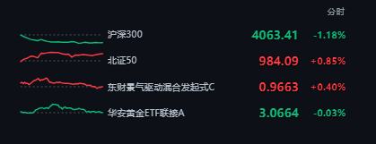
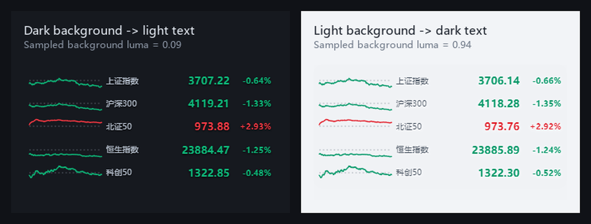
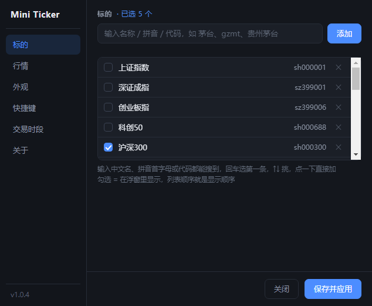

# Mini Ticker · 桌面盯盘浮窗

背景全透明的桌面行情浮窗。没有边框、没有面板、没有按钮堆叠，只有红绿折线和几个数字，贴在桌面任意角落，不挡视线。



## 特性

- **真透明**：无边框浮窗，背景完全透过去，叠在浏览器、编辑器、壁纸上都行
- **自动配色**：实时采样窗口背后的画面，背景亮就自动转暗色字，背景暗就转亮色字，不用手动切
- **多市场**：A 股、港股、美股、指数、ETF、场外基金混着盯
- **四种周期**：分时 / 日线 / 月线 / 年线，`Ctrl+1~4` 秒切，右上角常驻当前周期标识
- **聚焦图表**：`Ctrl+Alt+F` 把浮窗向右加宽，左边照旧是列表、右边长出一块图表区（分时 / 5日 / 日K，K 线 + 均线 + 成交量 + MACD），`↑↓` 或鼠标点行切换自选，中间分界线可拖动
- **可伸缩**：鼠标移到浮窗任意一边拖动改宽/改高，松手记住；右键菜单只有设置和退出，其余都在设置面板里
- **按名字搜**：中文名、拼音首字母、代码都能搜，不用背代码
- **尾盘提醒**：到点弹通知 + 任务栏闪烁
- **收盘自动退出 / 开盘自动启动**：工作日定时，节假日自己跳过
- **单实例**：重复启动只会激活已有窗口



## 快速开始

需要 Node.js 18 及以上。

```bash
git clone https://github.com/qqten/mini-ticker.git
cd mini-ticker
npm install
npm start
```

Windows 用户装好依赖后，直接双击 `start.cmd` 也行。

> 目前主要在 Windows 上验证。macOS / Linux 可以用 `npm start` 跑起来，但开盘自启（Windows 计划任务）那套不适用。

## 用法

| 操作 | 效果 |
| --- | --- |
| 左键拖动 | 移动浮窗 |
| 拖任意一边 | 改宽 / 改高（拖回内容高度会自动恢复自适应） |
| 右键 | 菜单：设置 / 退出 |
| `Ctrl+1` ~ `Ctrl+4` | 切分时 / 日线 / 月线 / 年线 |
| `Ctrl+R` | 立即刷新 |
| `Ctrl+Alt+F` | 展开 / 收起聚焦图表（窗口向右加宽） |

第一次使用建议右键 → 设置，把标的换成自己关心的。

涨跌幅跟着周期走：分时显示的是「今天涨跌」（相对昨收），切到日/月/年线后显示的是**这条折线覆盖区间的涨跌**（首点到末点），和曲线本身对得上。窗口拉高时每行和折线会一起变高，不会留空白。



## 聚焦图表

浮窗只放得下折线，要看细节就按 `Ctrl+Alt+F`，或者**直接在浮窗上左键单击**。**不另开窗口**，而是把当前窗口向右加宽：左边仍是原来那份列表（只留名称、点位差、涨跌幅三栏，折线换到右边大图里），右边多出来的是图表区。右边顶到屏幕边缘时会改成向左加宽，位置和高度都不变。背景依然是透明的，只有线条和文字。

| 视图 | 内容 |
| --- | --- |
| 分时 | 价格线 + 均价线 + 昨收虚线 + 每分钟成交量柱，左侧价格、右侧涨跌幅 |
| 5日 | 最近 5 个交易日分时首尾相接，每天一条昨收虚线，横轴标日期 |
| 日K | 蜡烛图 + MA5/MA10/MA20 + 成交量 + MACD(12,26,9) |

窗口内快捷键：

| 按键 | 效果 |
| --- | --- |
| `↑` / `↓` | 上一个 / 下一个（跟着列表里显示的那几行走，右上角显示 `3/6` 这样的位置） |
| 鼠标点行 | 直接切到那一行（跟 `↑↓` 等价） |
| `←` / `→` | 切视图 |
| `1` / `2` / `3` | 直接切分时 / 5日 / 日K |
| `Esc` | 收起图表，窗口恢复原宽度 |

拖动窗口（位移超过 4px）不算单击，所以展开之后照样可以拖着窗口跑，不会误触发。

**中间那条分界线可以直接拖**：窗口总宽不变，宽度在「列表」和「图表」之间重新分配。左列 220~640、图表至少留 200，鼠标移到线上会变亮。松手后左列宽度写回 `config.json` 的 `width`，收起窗口和下次展开都沿用这个宽度。

展开后拖边框改的是**图表区的宽度**，松手记住（`config.json` 里的 `focusChartWidth`），下次展开还是这么宽。全局快捷键可以在 `config.json` 里用 `focusHotkey` 改（Electron 的 accelerator 写法，比如 `CommandOrControl+Shift+K`）。

**列表变窄时先压缩数值**：宽度小于 300px 时点位和涨跌幅字号降一档、间距收紧；小于 240px 时收起迷你折线，把宽度全给名称。

## 添加标的

设置面板顶部直接输入名字即可，会弹出候选列表：

- 中文：`茅台`、`招商`
- 拼音首字母：`gzmt`
- 代码：`600519`、`sh600519`、`hk00700`、`usAAPL`
- 场外基金：`001186`

勾选 = 在浮窗里显示，列表顺序就是显示顺序。

## 配置文件

`config.json` 自动生成在项目根目录，也可以完全用设置面板改。首次运行会从默认值创建。

字段说明见 `config.example.json`。几个值得注意的：

| 字段 | 说明 |
| --- | --- |
| `symbols` | 浮窗里显示的标的，同时也是显示顺序 |
| `watchlist` | 候选池，设置面板里勾选的对象 |
| `period` | `minute` / `day` / `month` / `year` |
| `interval` | 刷新间隔（毫秒） |
| `alert` | 尾盘提醒开关与时间 |
| `autoExit` | 收盘自动退出时间，默认 `15:05`（留几分钟让收盘数据落定） |
| `autoStart` | 开盘自动启动时间，靠 Windows 计划任务实现 |
| `width` | 浮窗宽度，拖动边缘会自动写回 |
| `height` | 浮窗高度，`0` = 跟随内容自动撑开；手动拖过高就记住具体值 |

## 数据来源

全部走公开接口，只读，不需要任何账号：

- 腾讯财经：实时快照、分时、日/月 K 线（主源）
- 新浪财经：实时快照、分时、日/月 K 线（腾讯被 WAF 拦下时自动接管；港股美股只走它取快照）
- 天天基金：基金历史净值

腾讯的行情接口有两个等价入口（`ifzq.gtimg.cn` 与 `proxy.finance.qq.com`），主域名返回 WAF 挑战页时会自动换到备用域名；两个都挂了才落到新浪。切换会写一条日志到 `logs/app.log`。

新浪的 K 线接口只支持沪市 / 深市 / 北交所，港股美股的分时与 K 线仍然依赖腾讯。

调试时可以强制走新浪，验证兜底链路是否还活着：

```bash
set TICKER_FORCE_SINA=1 && start.cmd
```

接口是各家页面在用的公开接口，可能随时调整。挂了的话提 issue。

## 说明

- 仅供个人盯盘使用，不构成任何投资建议
- 窗口只在本地读取屏幕亮度用于配色，不截图保存、不上传
- 部分接口有频率限制，刷新间隔不建议低于 1 秒

## License

[MIT](LICENSE)
